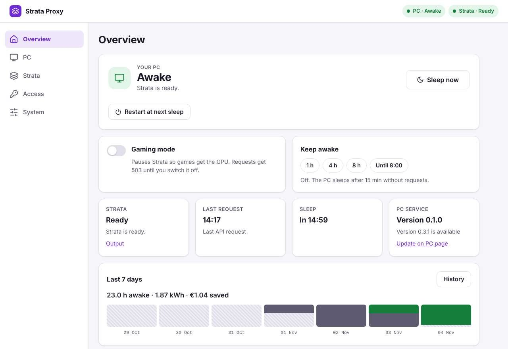

# Strata Home Proxy

Run a local LLM on your gaming PC without leaving the PC on all day.

Strata Home Proxy sits on an always-on box in your home network, such as a
NAS, in front of [Strata](https://github.com/Niko1221/Strata), the LLM engine
on your PC. Your apps (opencode, Claude Code, Open WebUI, scripts) talk only to
the proxy. When a request comes in and the PC is asleep, the proxy wakes it
with Wake on LAN, waits until Strata is ready and forwards the request. After
15 minutes without requests it sends the PC back to standby. While you play,
gaming mode keeps the PC awake and turns requests away right away.



## How it works

```
  apps (opencode, Claude Code, ...)
        |  OpenAI or Anthropic API, own API key per app
        v
  +-----------------------------+        wake packet (Wake on LAN)
  |  Proxy on the NAS (Docker)  | -------------------------------+
  |  web UI at /admin/          |                                |
  +-----------------------------+                                v
        |  requests, Strata key                +-------------------------------+
        +------------------------------------> |  Windows PC                   |
        |  state, sleep request, gaming mode   |  Strata (LLM engine)          |
        +------------------------------------> |  PC service (strata-pc-agent) |
                                               +-------------------------------+
```

- The **proxy** forwards every request to Strata and streams the answer back.
  It wakes the PC when needed and sends a sleep request after the idle timeout.
- The **PC service** is a small background program on the PC. It reports the
  PC's state, starts and watches Strata, switches gaming mode and puts the PC
  into standby when the proxy asks and nobody is using it.
- The **web UI** at `http://<NAS-IP>:8080/admin/` shows the PC and Strata live
  and is where you set everything up: the PC service, Strata and its models,
  API keys for your apps, benchmarks and the history.

More detail: [How it works](docs/how-it-works.md).

## What you need

- A **Windows PC** with a GPU for Strata that supports standby (S3) and Wake
  on LAN, connected to the network **by cable**.
- An **always-on x86-64 box** in the same network that runs Docker with host
  networking: a NAS with TrueNAS SCALE, Unraid or Synology, or a small Linux
  server. The image is built for `linux/amd64` only. The proxy needs little
  CPU and memory.
- A fixed IP address for the PC (a DHCP reservation in your router).

Strata itself is installed from the web UI later; you do not need it up front.

## Quick start

The full walkthrough, from BIOS settings to the first app, is the
[setup guide](docs/setup.md). In short:

1. Turn on Wake on LAN and standby on the PC, give it a fixed IP, and check
   that a wake packet from the NAS wakes it.
2. Start the proxy on the NAS with Docker Compose or as a TrueNAS app
   (`ghcr.io/faunkr/strata-home-proxy:latest`, `network_mode: host`).
3. Open `http://<NAS-IP>:8080/admin/`, log in with `admin` and set your own
   password. The checklist *Finish setup* on the Overview leads through the
   rest.
4. In the *PC* area, create the install command and run it in a PowerShell on
   the PC. This installs the PC service.
5. In the *Strata* area, press *Set up Strata*, then load a model.
6. In the *Access* area, create an API key for each app and point the app at
   `http://<NAS-IP>:8080`: [Connecting apps](docs/clients.md).

## Documentation

All pages are listed in [docs/README.md](docs/README.md). The most used ones:

- [Setup guide](docs/setup.md): the whole setup, with checks and troubleshooting
- [How it works](docs/how-it-works.md): waking, sleeping, API keys, gaming mode
- [Web UI](docs/web-ui.md): what each area shows and does
- [Connecting apps](docs/clients.md): opencode, Claude Code, Open WebUI
- [PC service](docs/pc-service.md): installing, updating and removing it
- [Automatic updates on TrueNAS](docs/nas-updates.md)
- [Development](docs/development.md): building and testing

## License

MIT, see [LICENSE](LICENSE).
